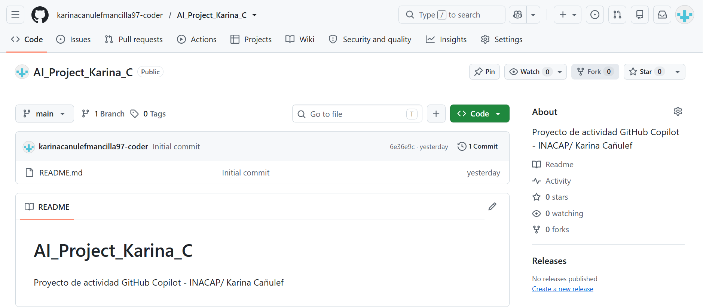
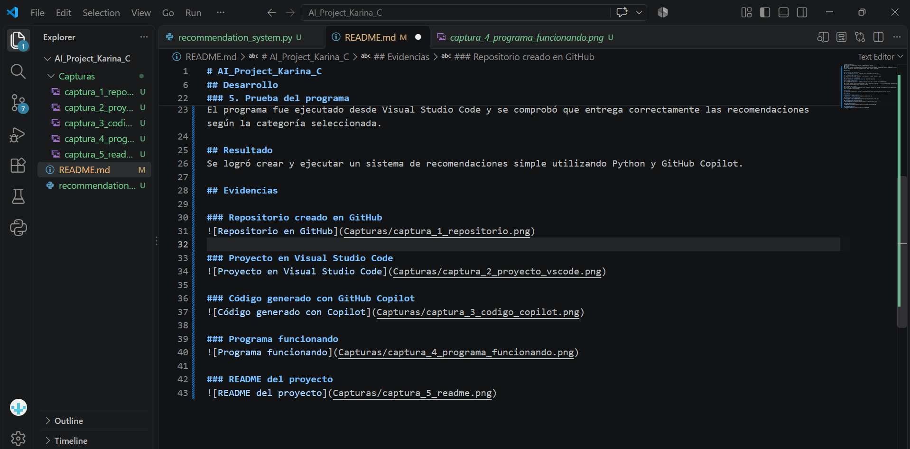
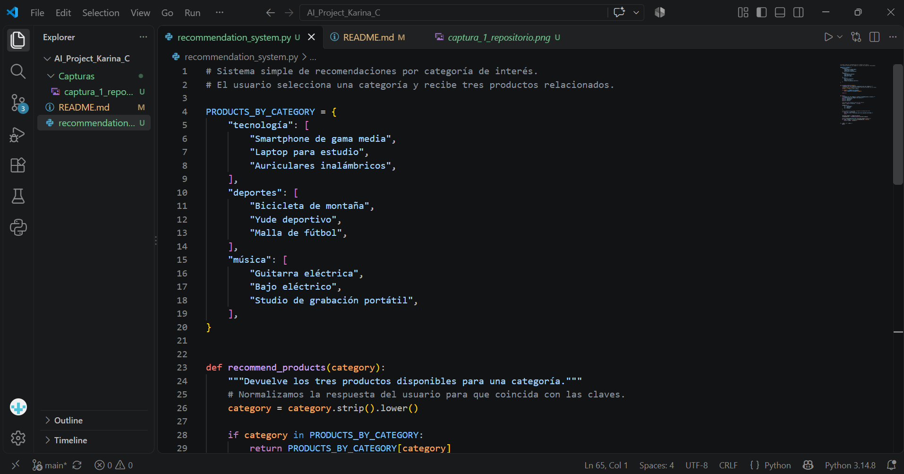
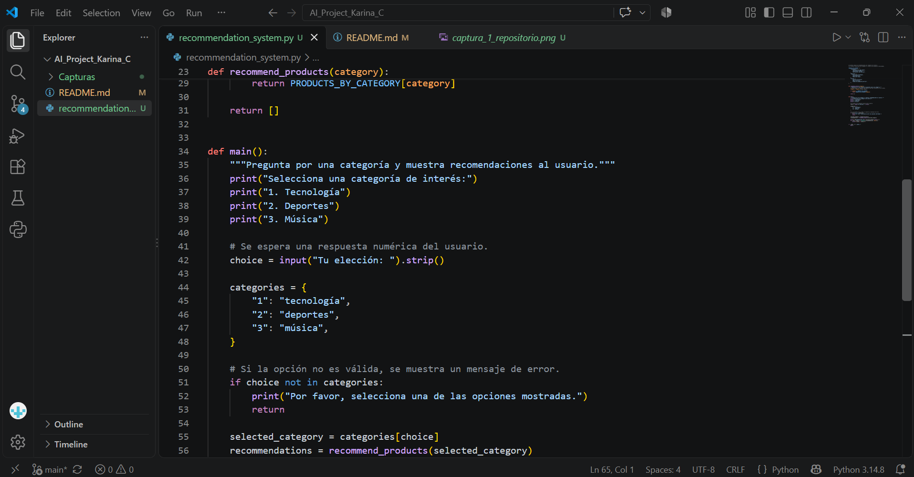
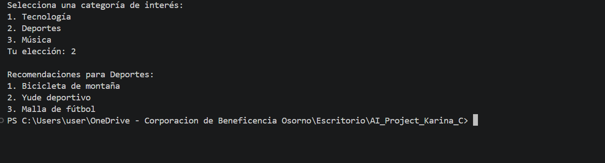
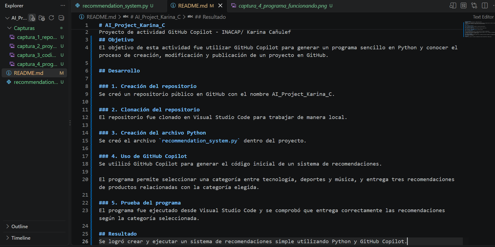

# AI_Project_Karina_C
Proyecto de actividad GitHub Copilot - INACAP/ Karina Cañulef
## Objetivo
El objetivo de esta actividad fue utilizar GitHub Copilot para generar un programa sencillo en Python y conocer el proceso de creación, modificación y publicación de un proyecto en GitHub.

## Desarrollo

### 1. Creación del repositorio
Se creó un repositorio público en GitHub con el nombre AI_Project_Karina_C.

### 2. Clonación del repositorio
El repositorio fue clonado en Visual Studio Code para trabajar de manera local.

### 3. Creación del archivo Python
Se creó el archivo `recommendation_system.py` dentro del proyecto.

### 4. Uso de GitHub Copilot
Se utilizó GitHub Copilot para generar el código inicial de un sistema de recomendaciones.

El programa permite seleccionar una categoría entre tecnología, deportes y música, y entrega tres recomendaciones de productos relacionadas con la categoría elegida.

### 5. Prueba del programa
El programa fue ejecutado desde Visual Studio Code y se comprobó que entrega correctamente las recomendaciones según la categoría seleccionada.

## Resultado
Se logró crear y ejecutar un sistema de recomendaciones simple utilizando Python y GitHub Copilot.

## Evidencias

### Repositorio creado en GitHub

### Proyecto en Visual Studio Code

### Código generado con GitHub Copilot

### Programa funcionando

### README del proyecto
